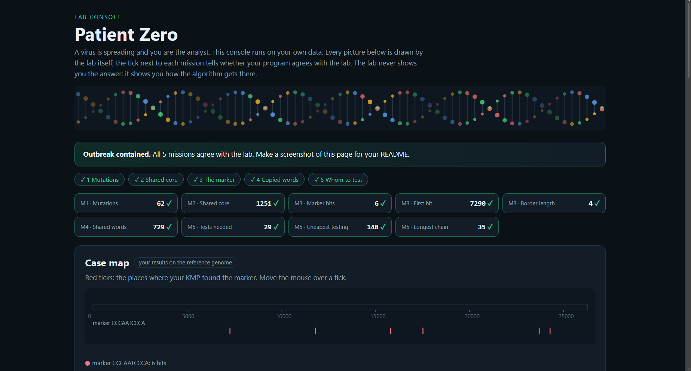

# Assignment 4. Patient Zero

Student ID: 251521
Name: Eraly Rempel
Group: SE-2512

This file is the report. Fill it in as you go. How to start: `START_HERE.md`. The task: `docs/Assignment4.pdf`.

## Program output

The 9 lines your program prints on your data (`java -cp out Main`):

    Mutations: 62
    Shared core: 1251
    Marker hits: 6
    First hit: 7290
    Border length: 4
    Shared words: 729
    Tests needed: 29
    Cheapest testing: 148
    Longest chain: 35

My outbreak report (a screenshot of `output/outbreak.html`):

## Questions

Answer in your own words, two or three sentences each.

Mission 1. What does the cell d[i][j] of your table mean, and how is it computed from other cells?
> The cell $d[i][j]$ represents the minimum edit distance (insertions, deletions, or substitutions) required to transform the prefix of strain A of length $i$ into the prefix of strain B of length $j$. It is computed by taking the minimum of transforming via deletion ($d[i-1][j] + 1$), insertion ($d[i][j-1] + 1$), or substitution ($d[i-1][j-1] + \text{cost}$).

Mission 2. How is the longest common subsequence different from the longest common substring? My Shared core is bigger than the number of letters that are the same at the same place: why?
> A longest common subsequence (LCS) allows gaps and matches characters in order without requiring them to be contiguous, whereas a longest common substring requires strict adjacency. The Shared core is bigger because mutations cause insertions and shifts, meaning shared subsequences are preserved across gaps rather than requiring exact index alignment.

Mission 3. What does the prefix function tell you, and why does the pointer in the text never go back in KMP? What is the Border length of my marker and what does it mean?
> The prefix function stores the length of the longest proper prefix that is also a suffix for every prefix of the pattern, allowing KMP to skip redundant comparisons so the text pointer never moves backward. The Border length is the final value of the prefix function, representing the longest proper prefix of the marker that is also its suffix.

Mission 4. Why must you compare the letters after the hashes are equal? What happens to the cost of Rabin-Karp if many windows have the same hash?
> Character verification is mandatory after hash equality because different windows can produce the same hash due to hash collisions. If many windows share the same hash, the time complexity of Rabin-Karp degrades due to frequent character-by-character verification checks in the worst case.

Mission 5. What are the two states of a person in your DP, and how do you get the answer for a person from its children? Why does a greedy "test the person with most links first" not always give the cheapest answer?
> The two states in the DP are whether person $v$ is tested ($\text{dp}[v][1]$) or not tested ($\text{dp}[v][0]$). If $v$ is tested, children can be either tested or not; if $v$ is not tested, all its children must be tested. Greedy strategies fail because making local choices based on degree can lead to suboptimal global edge coverage costs.

## AI use

The syllabus requires you to say which AI tools you used and for what. Write the tool (ChatGPT, Copilot, other) and what you asked it: explain an idea, find an error, review code. Write "none" if you did not use any. If you took code or text from a book or a website, give the source here.
> Gemini was used as a helper or an advisor to make me understand each mission, the help was given in understanding the briefings for each mission giving advices and hints help with understanding of code implementations, help with filling in the README.md that is where to put the output how to get the complexity.

## Timing (Mission 7)

Milliseconds, average of 3 runs, from `java -cp out Bench`.

| test | size | time |
|---|---|---|
| naive search | 20 000 / 40 000 / 80 000 | 101.6 ms / 175.2 ms / 335.2 ms |
| KMP | 20 000 / 40 000 / 80 000 | 6.0 ms / 3.1 ms / 0.5 ms |
| edit distance | 500 / 1000 / 2000 / 4000 | 13.8 ms / 9.5 ms / 39.8 ms / 140.1 ms |

What do the numbers say about how the time grows? When you double the size, by how much does each time grow? Two or three sentences.
> When the text size doubles, naive search time grows roughly linearly ($O(n)$), whereas KMP execution time remains extremely fast and efficient due to prefix-based skipping. When doubling the length for edit distance, the execution time roughly quadruples because its time complexity is $O(m \times n)$, scaling quadratically with input size.

## Complexity

n is the length of the text (or of a strain), m the length of the pattern, k the length of the window, v the number of people. Fill in every algorithm you wrote.

| algorithm | time | space | assumptions |
|---|---|---|---|
| Edit distance | $O(m \times n)$ | $O(m \times n)$ | $m$ and $n$ are lengths of the two strains |
| LCS | $O(m \times n)$ | $O(m \times n)$ | $m$ and $n$ are lengths of the two strains |
| Prefix function and KMP | $O(n + m)$ | $O(m)$ | $n$ is text length, $m$ is pattern length |
| Rabin-Karp (shared words) | $O(n + m)$ | $O(n)$ | Rolling hash with linear window scans |
| Tree DP | $O(V + E)$ | $O(V)$ | $V$ vertices, $E$ edges in the infection tree |